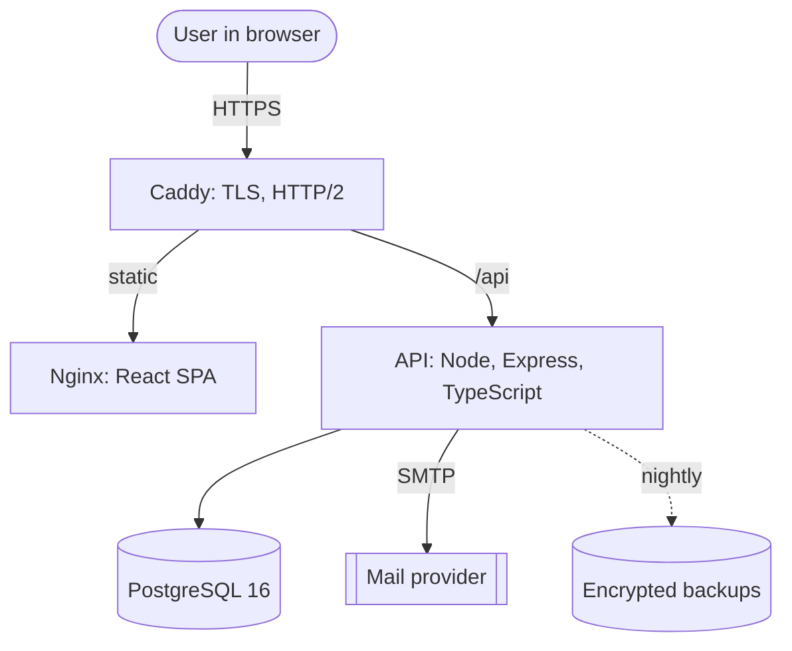
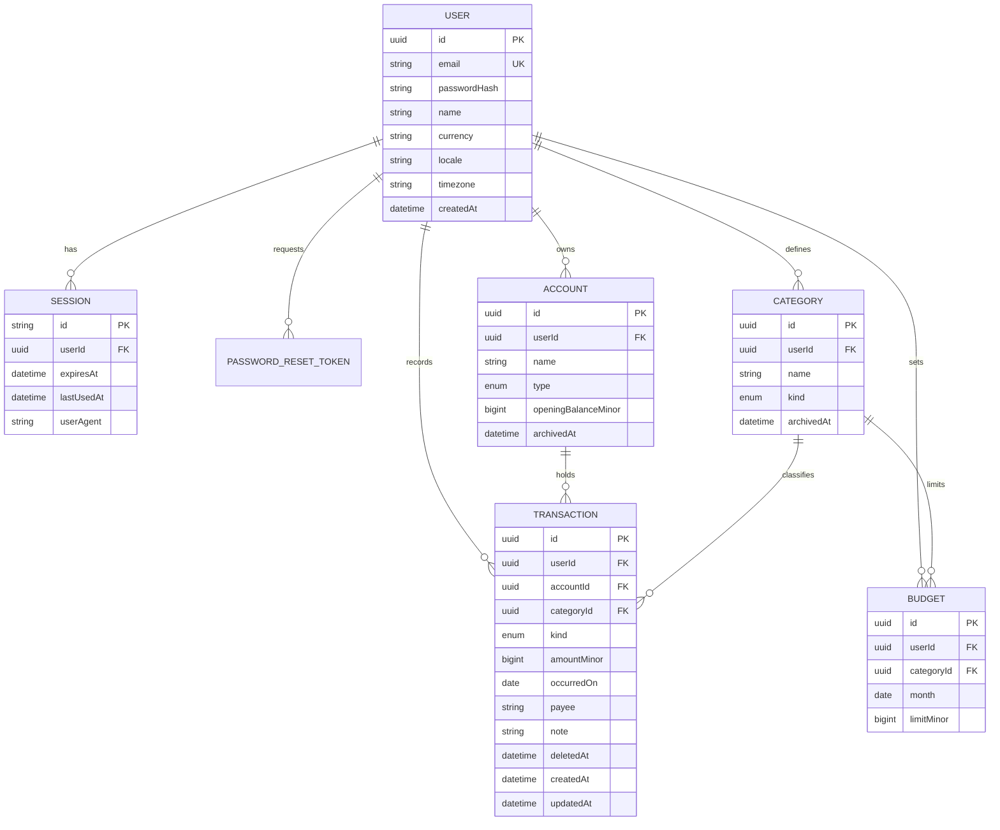
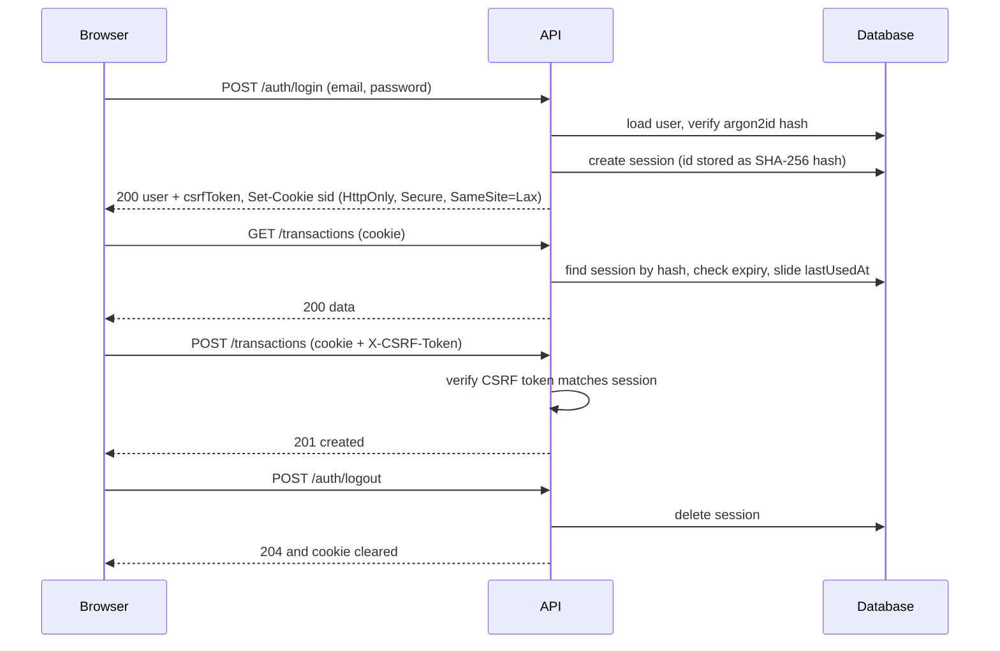
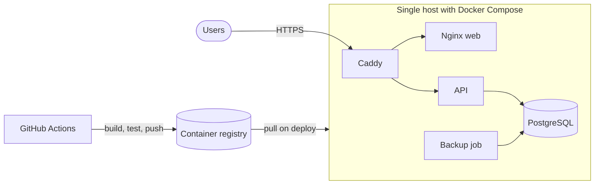

# Architecture: Masrouf

## 1. Goals and quality attributes

| Attribute | Target |
|---|---|
| Correctness | Money is never a float. Totals add up exactly. Month boundaries respect the user's timezone |
| Security | Every row belongs to one user and every query proves it. Sessions are revocable. Financial data never reaches logs |
| Clarity | A new developer understands the layers in an hour |
| Performance | API p95 under 150ms for list and report endpoints with 5 years of data for one user (about 20,000 rows). Web LCP under 2.5s, initial JS under 170KB gzipped |
| Testability | Money, date and pace rules are pure functions with thorough tests |
| Operability | One command locally, health checks, structured logs, repeatable deploys |

Scale: thousands of users, tens of thousands of rows per user. One small server and one PostgreSQL instance are enough. The scaling path is in section 12.

## 2. Style: layered modular monolith

One API process, organized by feature modules, each with the same internal layers. This is the simplest architecture that stays clean at this size (ADR-001).

```
controller   HTTP only: parse with Zod, call service, shape response
  -> service     use cases and business rules (pure where possible)
    -> repository  the only code that touches Prisma or SQL
domain/      pure functions: money, dates, pace, budget status (no I/O)
```

Modules: `auth`, `users`, `accounts`, `categories`, `transactions`, `budgets`, `reports`, `export`. Modules call each other only through service functions (no cross-module repository access). `reports` is read-only and uses its own SQL repository.

## 3. System context



The browser only ever talks to **one origin**. Caddy routes `/api` to the API, so cookies are first-party and CORS is not needed in production. In development, the Vite dev server proxies `/api` to the API for the same reason.

## 4. Data model



**Constraints and indexes (required)**

- Unique: `User.email` (stored lowercase), `Category(userId, kind, name)`, `Budget(userId, categoryId, month)`.
- `Transaction.amountMinor > 0` (check constraint). The sign comes from `kind`, never from the amount.
- Budgets reference **expense** categories only (enforced in the service and by a check on kind at write time).
- Indexes: `Transaction(userId, occurredOn DESC, id DESC)` (list and keyset paging), `Transaction(userId, categoryId, occurredOn)` (category reports), `Transaction(userId, kind, occurredOn)` (summaries), partial index `WHERE deletedAt IS NULL` on the first two, `Session(userId)`, `Session(expiresAt)`.
- Foreign keys are explicit. Deleting a user cascades to all their rows (account deletion is a real erase). Deleting a category or account that has transactions is refused. Archive it instead.
- Every table that holds user data has `userId`. Repositories **always** filter by it (section 7).

## 5. Money and date rules (domain)

These are the most error-prone part of a finance app, so they are specified once and implemented in `packages/contracts` with exhaustive tests.

**Money**
- Stored and transported as **integer minor units** (`amountMinor`): TND has 3 decimals (1 TND = 1000 millimes), EUR and USD have 2. Database type is `bigint`. JSON uses a number (safe-integer checked), never a float amount.
- A currency table defines the exponent (`TND: 3, EUR: 2, USD: 2`). Each user has one currency in v1. Multi-currency is out of scope.
- `parseMoney("12.5", "TND") -> 12500` is string parsing, **never** `parseFloat(x) * 1000`. `formatMoney(minor, currency, locale)` uses `Intl.NumberFormat`.
- Aggregations happen in SQL on integers (`SUM(amountMinor)`). Percentages and rates are computed from integers at the edge and rounded once for display.

**Dates**
- `occurredOn` is a SQL `date` (the calendar day the user means), not a timestamp. API format is `YYYY-MM-DD`.
- "Today", month start and month end are computed in the **user's timezone** (default `Africa/Tunis`), then passed to SQL as plain dates. The server never uses its own timezone for business logic.
- Months are identified as `YYYY-MM` in the API and stored as the first day (`date`) in `Budget.month`.

**Pace**
- `expectedFraction = dayOfMonth / daysInMonth` for the current month, and `1` for past months.
- Budget status: `OVER` if spent > limit, else `AHEAD` if spent/limit > expectedFraction, else `ON_PACE`. Future months have no pace (`UPCOMING`).
- Spending pace comparison aligns this month and the previous month **by day of month** and clips the previous month to the same day for the headline comparison.

## 6. Authentication and session design



- **Opaque server-side sessions** in the database (ADR-004). The cookie holds a random 256-bit id, the database holds its SHA-256 hash. Revocation is a row delete, no token blacklist is needed.
- Cookie: `__Host-sid` in production (`Secure; HttpOnly; SameSite=Lax; Path=/`), `sid` in development over HTTP. Idle timeout 7 days (sliding), absolute lifetime 30 days. A new session id is issued at login and the old one is discarded.
- **CSRF:** `SameSite=Lax` plus a per-session CSRF token returned by `/auth/me` and `/auth/login`, sent by the client as `X-CSRF-Token` on every unsafe request, and an `Origin` header check.
- Password change and "sign out everywhere" delete all sessions of the user. Details and threats are in [SECURITY.md](SECURITY.md).

## 7. Authorization (single-tenant data)

There are no roles in v1: every authenticated user can access **only their own** data. This is enforced in layers:

1. `requireAuth` middleware attaches `req.user`. Routes without it fail a CI check unless marked public.
2. **Every repository function takes `userId` as its first argument** and puts it in the `where` clause. There is no repository method that fetches by id alone.
3. Foreign keys supplied by the client (`accountId`, `categoryId`) are verified to belong to the same user before use.
4. Cross-user access returns `404`, never `403`, so existence is not revealed.
5. Optional hardening (stretch): PostgreSQL row-level security with `SET app.user_id` per request as a second wall.

## 8. Reporting design

Reports are computed in PostgreSQL, over integer amounts, scoped by `userId` and the date range. No report loads rows into Node to sum them.

| Report | Approach |
|---|---|
| Summary | `SUM(amountMinor) FILTER (WHERE kind = ...)` for the range and for the previous equal-length range, in one query |
| Spending pace | `generate_series` of days in the month `LEFT JOIN` daily expense sums, then a window `SUM() OVER (ORDER BY day)` for the cumulative line. Run for this and the previous month |
| By category | `GROUP BY categoryId ORDER BY SUM DESC`, share computed from the total, optional comparison with the previous range |
| Trend | `date_trunc('month', occurredOn)` grouped, with missing months filled by `generate_series` |
| Budgets | Join budgets for the month with category spend for the month, status from the pace rules in the service |
| Top payees | `GROUP BY lower(payee)` with count and sum, limited |
| Export | Stream rows as CSV with a cursor, never build the whole file in memory |

Rules: every report endpoint accepts a validated date range or month. All range queries use half-open intervals (`>= from AND < to`). Each report has an integration test with hand-computed expected values.

## 9. API conventions and catalog

- Base path `/api/v1`. JSON (plus CSV for export). OpenAPI generated from the Zod contracts at `/api/docs` in development.
- Success `{ data, meta? }`. Error `{ error: { code, message, fields?, requestId } }`. Statuses: 200, 201, 204, 400, 401, 403, 404, 409, 422, 429, 500.
- **Cursor (keyset) pagination** for transactions: `limit` (default 25, maximum 100) and `cursor`, ordered by `(occurredOn DESC, id DESC)`. Response `meta: { nextCursor }`.
- Creates accept an optional client-generated `id` (UUID) so a retried request does not create duplicates (idempotent).
- Deletes are **soft** (`deletedAt`) with `POST /transactions/:id/restore` powering the Undo toast. A nightly job purges rows soft-deleted over 30 days ago.

| Module | Endpoints |
|---|---|
| auth | `POST /auth/register`, `/auth/login`, `/auth/logout`, `/auth/logout-all`, `/auth/forgot-password`, `/auth/reset-password`, `/auth/change-password`. `GET /auth/me` |
| users | `PATCH /me` (name, currency, locale, timezone), `GET /me/export` (JSON of all data), `DELETE /me` |
| accounts | `GET /accounts` (with computed balances), `POST /accounts`, `PATCH /accounts/:id`, `POST /accounts/:id/archive` |
| categories | `GET /categories?kind=`, `POST /categories`, `PATCH /categories/:id`, `POST /categories/:id/archive` |
| transactions | `GET /transactions` (filters `from`, `to`, `kind`, `accountId`, `categoryId`, `q`, `min`, `max`, `sort`, `cursor`, `limit`), `POST`, `GET /:id`, `PATCH /:id`, `DELETE /:id`, `POST /:id/restore`, `GET /transactions/export.csv` |
| budgets | `GET /budgets?month=YYYY-MM`, `PUT /budgets/:month/:categoryId` (upsert), `DELETE /budgets/:month/:categoryId`, `POST /budgets/:month/copy-from-previous` |
| reports | `GET /reports/summary`, `/reports/spending-pace`, `/reports/by-category`, `/reports/trend`, `/reports/budgets`, `/reports/top-payees` |
| ops | `GET /health`, `GET /ready` |

## 10. Non-functional design

**Performance:** indexes in section 4, keyset pagination, one aggregated call per dashboard (`/reports/summary` plus `/reports/spending-pace` plus `/budgets`), `ETag` and `Cache-Control: private, no-cache` on report reads, TanStack Query `staleTime` on the client, route-level code splitting, charts as lazy chunks. No Redis in v1 (ADR-005).

**Observability:** structured JSON logs (pino) with `requestId`, user id, route, status and duration. **Never log amounts, payees, notes or emails.** `/health` and `/ready`.

**Resilience:** request timeouts, body limit, graceful shutdown, connection pool sized for the instance, migrations as an explicit deploy step.

**Data protection:** the user can export everything and delete the account (real erase). Nightly encrypted backup with a documented restore test.

## 11. Deployment architecture



Environments: `local` (compose with Postgres and Mailpit), `production`. The same images are used everywhere, configuration is environment-only. Details in the README.

## 12. Scalability path

| Pressure | Change |
|---|---|
| More than one API instance | Sessions already live in the database, so the API is stateless. Add a shared rate-limit store (Redis) |
| Slow reports on large accounts | Monthly rollup table maintained on write, or a materialized view refreshed on change |
| Emails, exports, recurring transactions | Job queue (BullMQ on Redis) and a scheduler |
| Receipt attachments | S3-compatible object storage behind a `StorageService` interface |
| Multiple currencies | Currency on each transaction plus a daily rates table and reports in a base currency |

## 13. Architecture decision records

| ADR | Decision | Why | Alternatives rejected |
|---|---|---|---|
| 001 | Layered modular monolith | Right size for the team and data volume, clear seams | Microservices (cost without benefit) |
| 002 | Express with TypeScript, Zod contracts shared with the web | Lightweight and well understood, one schema for both sides | NestJS (more ceremony than this scope needs) |
| 003 | PostgreSQL with Prisma, raw SQL for reports | Strong constraints and typed CRUD, plus full SQL power for aggregates | MongoDB (relational and aggregate-heavy), ORM-only reports |
| 004 | Server-side cookie sessions with CSRF token | First-party SPA, instant revocation, no token in JavaScript | JWT in localStorage (XSS exposure), JWT plus refresh (more moving parts than needed) |
| 005 | No Redis in v1 | Not needed at this scale | Add on day one (premature) |
| 006 | Integer minor units, `date` for days, user timezone for boundaries | Eliminates rounding and timezone bugs | Floats and decimals in JS, timestamps for days |
| 007 | Custom SVG charts with d3-scale and d3-shape | Full control over chrome, accessibility and bundle size | Charting kit (default chrome, heavier) |
| 008 | Soft delete with Undo, purge after 30 days | Safe, fast mistakes recovery | Hard delete with confirm dialog |
| 009 | Single-origin deployment behind Caddy | First-party cookies, no CORS surface, automatic HTTPS | Separate origins for web and API |

New decisions get a new row in the same change that introduces them.

## 14. Repository structure

```
.
├── apps/
│   ├── api/
│   │   ├── prisma/                schema.prisma, migrations/, seed.ts
│   │   └── src/
│   │       ├── main.ts, app.ts
│   │       ├── config/            env validation
│   │       ├── middleware/        auth, csrf, validate, error-handler, rate-limit
│   │       ├── lib/               prisma, logger, mailer, app-error
│   │       └── modules/<name>/    controller, service, repository, tests
│   └── web/
│       └── src/
│           ├── app/               router, providers, shell (TopBar)
│           ├── components/ui/     design-system primitives
│           ├── components/charts/ SpendingPaceChart, MonthlyBars, CategoryBars, PaceBar
│           ├── features/<name>/   api, components, hooks, pages, copy.ts
│           ├── lib/               http client, csrf, formatting
│           └── styles/            tokens.css, globals.css
├── packages/contracts/            Zod schemas, money and date functions, enums, error codes
├── docs/                          ARCHITECTURE, DESIGN_SYSTEM, SECURITY, design-reference.html
├── deploy/                        Dockerfiles, compose, Caddyfile, nginx.conf
└── .agents/                       rules, skills, workflows
```
